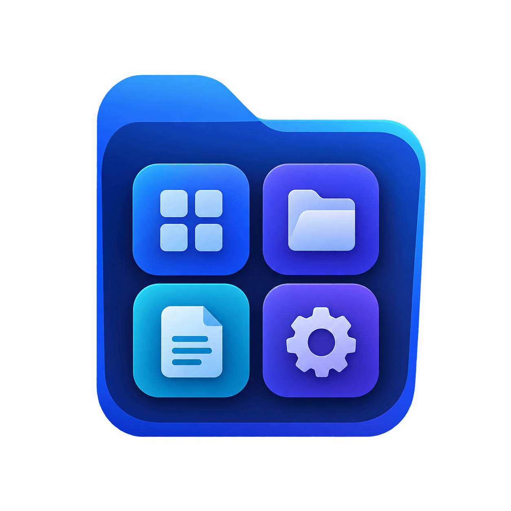
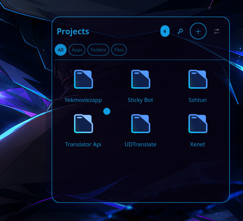
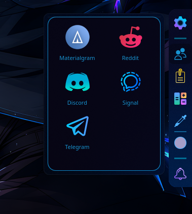
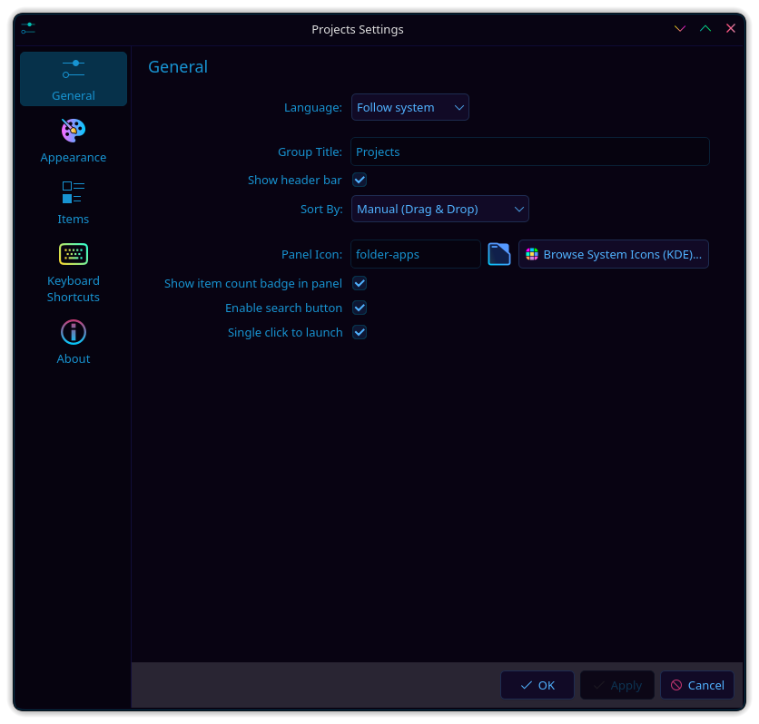
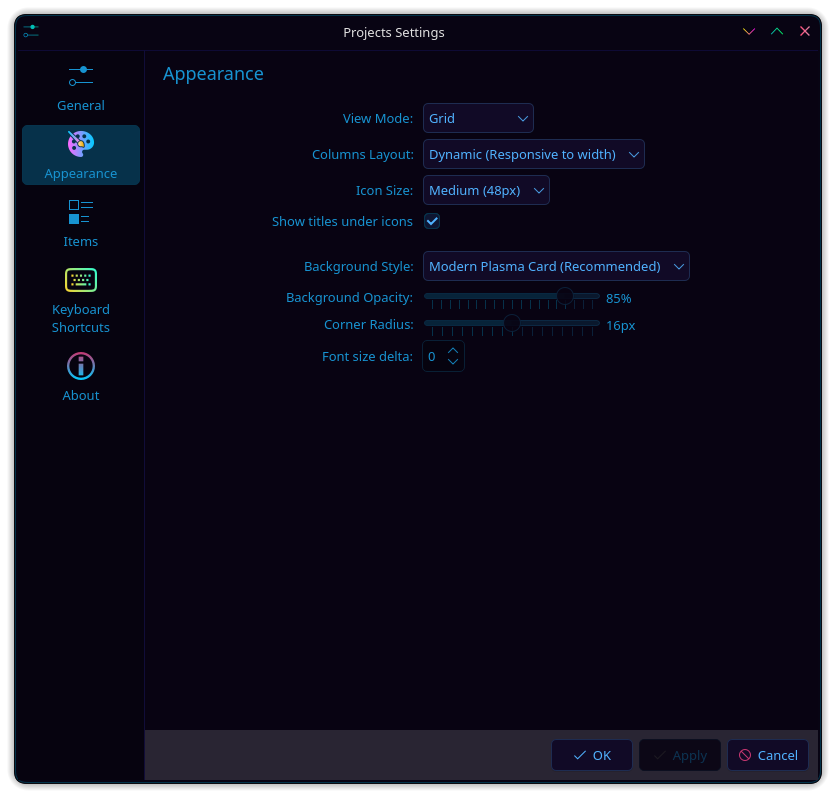
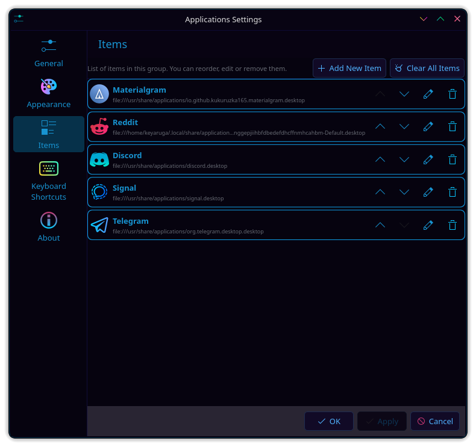

<div align="center">



# گروه برنامه‌ها &nbsp;·&nbsp; Application Group

### دسته‌بندی برنامه‌ها، پوشه‌ها و پرونده‌ها در جعبه‌هایی آراسته روی دسکتاپ و پنل KDE Plasma&nbsp;6

<p>
  
  
  
  
</p>

<p>
  <a href="README.md">English</a> &nbsp;•&nbsp; <a href="README_FA.md"><b>فارسی</b></a>
</p>

<p>
  <a href="https://www.opendesktop.org/p/2378509/"><b>دریافت از فروشگاه KDE</b></a>
  &nbsp;·&nbsp;
  <a href="https://github.com/keyaruga33/application-group-widget/releases">انتشارها</a>
  &nbsp;·&nbsp;
  <a href="https://github.com/keyaruga33/application-group-widget/issues">گزارش خطا</a>
</p>

</div>

---

 &nbsp;**گروه برنامه‌ها** (Application Group) ویجتی سبک و کارآمد برای KDE Plasma 6 است که برای حل یک دردسر همیشگی ساخته شده: شلوغیِ آزاردهندهٔ دسکتاپ و گشتن‌های پیاپی در منوهای تو‌در‌تو.

به جای اینکه تصویر پس‌زمینهٔ خود را با ده‌ها میان‌بر پراکنده بپوشانید یا برای اجرای چند ابزار کاری هر بار منوی برنامه‌ها را زیر و رو کنید، همه‌چیز را در دسته‌های مرتب، شفاف و دم‌دست کنار هم قرار دهید.

می‌توانید یک گروه را روی **دسکتاپ** بنشانید تا مثل یک تابلوی کاری همیشه باز باشد، یا آن را به **پنل** بسپارید تا در قالب یک نماد کوچک با نشانگر تعداد، گوشهٔ صفحه بماند و با کلیک باز شود. پرونده‌ها را از Dolphin بکشید و رها کنید، با دکمهٔ **سنجاق (📌)** پنجره را باز نگه دارید تا بدون بسته شدن پوشه‌ها را مرتب کنید، نمادها را با ابزار رسمی انتخاب نماد KDE عوض کنید و از هماهنگی خودکار با رنگ‌های سیستم لذت ببرید.

##  &nbsp;تصاویر

<div align="center">

<table>
  <tr>
    <td align="center"><br><sub><b>حالت دسکتاپ</b> — محیط کار و پوشه‌های هر پروژه، درست روی تصویر زمینه</sub></td>
    <td align="center"><br><sub><b>حالت پنل</b> — دسترسی سریع با پاپ‌آپ و پشتیبانی از سنجاق کردن</sub></td>
  </tr>
</table>

<table>
  <tr>
    <td align="center"><br><sub>تنظیمات عمومی و پنل</sub></td>
    <td align="center"><br><sub>پوسته، نما و رنگ‌بندی</sub></td>
    <td align="center"><br><sub>مدیریت و چیدمان گزینه‌ها</sub></td>
  </tr>
</table>

</div>

##  &nbsp;ویژگی‌ها و کاربردهای روزمره

برای شروع نیازی به پیش‌نیازهای عجیب، دیمن‌های پس‌زمینه یا تنظیمات پیچیده نیست؛ ویجت را اضافه کنید و بلافاصله به کار بگیرید.

###  &nbsp;کشیدن و رها کردن هر چیز (Drag &amp; Drop)

هر موردی را مستقیماً از Dolphin، دسکتاپ یا مرورگر بکشید و داخل ویجت رها کنید:

| نوع آیتم | چند نمونه | نحوهٔ رفتار ویجت |
| -------- | --------- | ---------------- |
| **برنامه‌ها و فایل‌های `.desktop`** | Firefox، تلگرام، Dolphin، اسکریپت‌های `.desktop` | مستقیماً به شکل نرم‌افزار با KIO اجرا می‌شوند (هرگز در ادیتور Kate باز نمی‌شوند) |
| **پوشه‌ها و شاخه‌ها** | پوشهٔ اسناد، پروژه‌ها، ریشه‌ها | در مدیر پروندهٔ Dolphin باز می‌شوند |
| **اسناد و فایل‌های رسانه** | PDF، پرونده‌های متنی، تصاویر | با نمایشگر پیش‌فرض سیستم (مانند Okular یا Gwenview) باز می‌شوند |
| **پیوندهای وب** | نشانی‌های اینترنتی و مستندات وب | مستقیماً در مرورگر پیش‌فرض گشوده می‌شوند |

###  &nbsp;دسکتاپ یا پنل؛ دست شما باز است

ویجت را هر جا که با گردش کار شما هماهنگ‌تر است قرار دهید:

- **روی دسکتاپ**: نمایی دائمی با پس‌زمینهٔ کارت شیشه‌ای، تخت یا قاب‌دار با امکان تعیین میزان تاری (Opacity) و گردی گوشه‌ها.
- **در پنل**: در قالب یک نماد جمع‌وجور می‌نشیند. یک نشانگر با کنتراست بالا تعداد آیتم‌ها را نشان می‌دهد و کشیدن پرونده روی نماد پنل، پنجره را به شکل خودکار باز می‌کند تا بتوانید آیتم‌ها را رها کنید.

###  &nbsp;دکمهٔ کارآمد سنجاق (📌)

در حالت پنل، پاپ‌آپ‌ها با کلیک بیرون از پنجره سریع بسته می‌شوند. وقتی می‌خواهید چند پرونده را پشت سر هم از Dolphin به داخل ویجت منتقل کنید، این بسته شدن مکرر خسته‌کننده می‌شود.

کافی است روی **دکمهٔ سنجاق (📌)** در بالای پنجره کلیک کنید (یا در منوی راست‌کلیک سنجاق را برگزینید). پنجره روی دیگر برنامه‌ها ثابت می‌ماند و می‌توانید با خیال راحت پنجره‌های دیگر را مدیریت کنید و فایل‌هایتان را بچینید.

###  &nbsp;جستجوگر داخلی برنامه‌های سیستم

نمی‌خواهید برای اضافه کردن برنامه‌ها در مسیرهای فایل سیستم سرک بکشید؟ روی **افزودن (+) ← برنامه‌های سیستم** کلیک کنید:

- جستجوی بلادرنگ در میان تمام نرم‌افزارهای نصب‌شده روی سیستم با مدل بومی KDE.
- پالایش سریع بر پایهٔ نام، توضیحات یا دسته‌بندی دسکتاپ.
- اضافه شدن با یک کلیک همراه با نماد رسمی و تنظیمات دقیق اجرایی.

###  &nbsp;انتخاب‌گر رسمی نماد KDE

نیازی به حفظ کردن نام فایل آیکون‌ها نیست. کلیک روی انتخاب نماد، پنجرهٔ رسمی `KIconThemes.IconDialog` کی‌دی‌ای را باز می‌کند تا با جستجو و پیش‌نمایش گرافیکی، هر نمادی از تم فعال سیستم را انتخاب کنید.

###  &nbsp;جابجایی سریع با کشیدن درون جعبه

کارت‌ها را دقیقاً همان‌طور که راحت‌تر هستید مرتب کنید. هر کارت را با ماوس بگیرید و به چپ یا راست بکشید؛ خط نشانه به شما نشان می‌دهد که پس از رها کردن، کارت در چه جایگاهی قرار می‌گیرد.

###  &nbsp;منوی راست‌کلیک در تمام بخش‌ها

روی هر کارت راست‌کلیک کنید تا گزینه‌های ویرایش، حذف، باز کردن پوشهٔ مربوطه یا تغییر چیدمان در اختیارتان باشد.

حتی اگر نوار بالای ویجت را پنهان کنید تا ظاهری کاملاً مینیمال داشته باشید، با راست‌کلیک روی فضای خالی پس‌زمینه، منویی برای سنجاق کردن، افزودن آیتم یا باز کردن تنظیمات نمایش داده می‌شود.

###  &nbsp;پشتیبانی طبیعی از زبان فارسی و راست‌به‌چپ (RTL)

این ویجت از ریشه برای کاربران فارسی‌زبان طراحی و بهینه‌سازی شده است:

- **گزینه‌های زبان**: فارسی، انگلیسی، یا پیروی خودکار از زبان سامانه.
- **راست‌به‌چپ اصیل**: تمام بخش‌ها، نشانگرها، کادر جستجو و حرکت کارت‌ها در حالت فارسی به صورت کاملاً متقارن و بدون بهم‌ریختگی آینه‌ای می‌شوند.
- واژگان رسا و نزدیک به پارسی سره با حفظ اصطلاحات آشنای فنی.

##  &nbsp;روش‌های نصب

###  &nbsp;روش آسان — فروشگاه KDE

1. روی پنل یا دسکتاپ راست‌کلیک کنید و **Add or Manage Widgets…** را بزنید.
2. به بخش **Get New…** ← **Download New Plasma Widgets** بروید.
3. نام **Application Group** را جستجو کنید.
4. روی **Install** کلیک کنید و سپس آن را روی دسکتاپ یا پنل بکشید.

>  **[مشاهدهٔ Application Group در فروشگاه KDE →](https://www.opendesktop.org/p/2378509/)**

###  &nbsp;از طریق فایل بستهٔ انتشاری

1. آخرین بستهٔ `.zip` را از برگهٔ [Releases](https://github.com/keyaruga33/application-group-widget/releases) دریافت کنید.
2. روی دسکتاپ راست‌کلیک کرده و از بخش **Add Widgets…** وارد **Get New…** شوید.
3. گزینهٔ **Install From Local File…** را انتخاب کرده و فایل دانلود شده را برگزینید.

###  &nbsp;نصب از سورس کد

```bash
git clone https://github.com/keyaruga33/application-group-widget.git
cd application-group-widget
make install
```

برای به‌روزرسانی بستهٔ نصب‌شده پس از دریافت تغییرات:

```bash
make upgrade
```

##  &nbsp;تنظیمات

با راست‌کلیک روی ویجت و انتخاب **Configure Application Group…**، تنظیمات در سه بخش در دسترس شماست:

<table>
  <tr>
    <td valign="top" width="33%">
      <b> عمومی</b><br><br>
      • عنوان دلخواه گروه و نمایش نوار بالا<br>
      • فعال‌سازی نوار جستجوی سریع<br>
      • گزینش نماد پنل با دیالوگ رسمی KDE<br>
      • نشانگر تعداد آیتم‌ها با رنگ متمایز<br>
      • اجرای برنامه‌ها با تک‌کلیک یا دوبار‌کلیک<br>
      • شیوهٔ مرتب‌سازی (دستی، الفبایی، کاربرد)<br>
      • زبان (خودکار، فارسی، انگلیسی)
    </td>
    <td valign="top" width="33%">
      <b> ظاهر و نما</b><br><br>
      • حالت نمایش: شبکه‌ای (Grid) یا فهرستی (List)<br>
      • تعداد ستون‌ها: خودکار پویا یا ثابت (۲ تا ۸)<br>
      • اندازهٔ نمادها: از کوچک (۲۴) تا بسیار بزرگ (۶۴)<br>
      • سبک کارت‌ها: کارتی نوین، شیشه‌ای، تخت، حاشیه‌دار<br>
      • اسلایدر شفافیت پس‌زمینه و گردی گوشه‌ها<br>
      • نمایش یا پنهان‌سازی عنوان‌ها و اندازهٔ قلم
    </td>
    <td valign="top" width="33%">
      <b> گزینه‌ها</b><br><br>
      • مدیریت کامل تمام آیتم‌های ذخیره‌شده<br>
      • جابجایی آیتم‌ها به بالا و پایین<br>
      • ویرایش نام، آیکون و مسیر هدف<br>
      • مرور و افزودن از برنامه‌های نصب‌شده<br>
      • حذف تکی یا پاک‌سازی تمام گزینه‌ها
    </td>
  </tr>
</table>

##  &nbsp;سبک و آرام روی سخت‌افزار

یک ویجت روی دسکتاپ نباید بار پردازنده ایجاد کند:

- **بدون پولینگ بیهوده**: در حالت آماده‌به‌کار هیچ چرخه‌ای از CPU مصرف نمی‌شود.
- **اجرای مستقل و پایدار**: باز کردن برنامه‌ها مستقیماً به سازوکار امن KIO و پروسس رانر سیستم واگذار می‌شود تا میزکار معطل نماند.
- **بارگذاری تنبل**: فهرست برنامه‌های سیستم تنها زمانی پویش می‌شود که پنجرهٔ افزودن باز شود، تا سرعت بالا آمدن Plasma حفظ شود.

##  &nbsp;پیش‌نیازها

- **KDE Plasma 6.0** یا جدیدتر
- **Qt 6**

> گروه برنامه‌ها ویژهٔ معماری مدرن Plasma 6 با استفاده از اجزای Kirigami طراحی شده و روی Plasma 5 یا میزکارهای غیر از KDE اجرا نمی‌شود.

##  &nbsp;برنامه‌های آینده

- دسته‌بندی چند زبانه‌ای (Tabs) درون یک ویجت واحد
- خطوط تفکیک دسته‌بندی در حالت فهرستی
- پیش‌نمایش تصویر بندانگشتی برای اسناد و عکس‌ها
- نشانگرهای وضعیت اجرای برنامه‌ها

##  &nbsp;مشارکت در توسعه

اگر خطایی دیدید، ایده‌ای برای زیباتر شدنش دارید یا می‌خواهید امکانی اضافه کنید، با کمال میل استقبال می‌کنیم:

-  در بخش **[Issues گیت‌هاب](https://github.com/keyaruga33/application-group-widget/issues)** گزارش خطا بگذارید یا ایده بدهید.
-  برای پیاده‌سازی بهبودها، **Pull Request** ارسال کنید.

##  &nbsp;مجوز

این نرم‌افزار کاملاً رایگان و متن‌باز است و تحت پروانهٔ **[GPL-3.0](LICENSE)** منتشر می‌شود.

##  &nbsp;حمایت

اگر این ویجت برای کار روزانهٔ شما مفید بوده، دادن یک **⭐ ستاره** در گیت‌هاب مایهٔ دلگرمی بزرگی است.

همچنین اگر مایل بودید می‌توانید با خرید یک قهوه از توسعهٔ مداوم آن پشتیبانی کنید:

>  **[یک قهوه مهمانم کنید →](https://www.coffeete.ir/keyaruga333)**

##  &nbsp;پیوندها

| | |
| --- | --- |
|  مخزن گیت‌هاب | https://github.com/keyaruga33/application-group-widget |
|  فروشگاه KDE | https://www.opendesktop.org/p/2378509/ |
|  نسخه‌ها و انتشارهای آماده | https://github.com/keyaruga33/application-group-widget/releases |
|  ثبت گزارش و پیشنهاد | https://github.com/keyaruga33/application-group-widget/issues |

<div align="center">
<br>

 &nbsp;**ساخته‌شده برای KDE Plasma 6** &nbsp;·&nbsp;  &nbsp;_میز کار خود را مرتب، شکیل و همیشه آمادهٔ استفاده نگه دارید._

</div>
